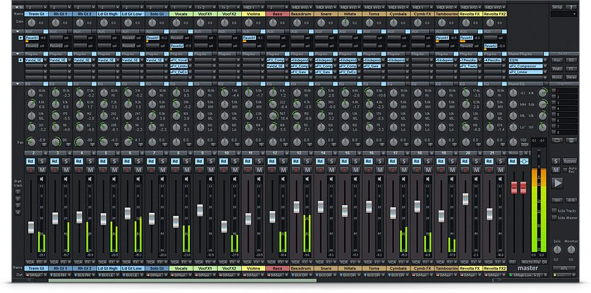

# MAGIX Samplitude Pro for Multitrack Audio Production

[](https://magix-samplitude-pro.github.io/Samplitude-Pro/)

MAGIX Samplitude Pro is the product search name used for this recording, editing, and mixing guide.
Samplitude Pro workflows combine multitrack sessions with detailed control over individual audio objects.

Samplitude moved from MAGIX to Boris FX in 2025.
Verify the installed release and edition before following instructions or comparing included tools.

The accompanying source snapshot belongs to LMMS.
Its files illustrate a separate open-source music application and are not Samplitude source code.

## Features

The current vendor describes recording, object-based processing, MIDI support, and mixing tools.
Keep release-specific features separate from the capabilities of older Samplitude Pro X versions.

| Production task | Working decision | Review point |
| --- | --- | --- |
| Recording | Select the intended input and track | A short test captures the expected signal |
| Editing | Choose the object or time selection | Boundaries and fades sound clean |
| Comping | Select the preferred parts of takes | Transitions preserve the performance |
| Mixing | Route tracks and balance processing | The intended buses reach the output |
| Automation | Define which parameter changes over time | Playback follows the intended movement |
| Delivery | Choose format, channels, and sample rate | The exported file matches the specification |

Object-based editing can place processing on an individual clip.
Track processing and object processing should be reviewed separately when tracing a sound.

Keep the session understandable with descriptive track and object names.
Save a revision before substantial edits to an arrangement.


The LMMS reference [AutomationTrackTest.cpp](tests/src/tracks/AutomationTrackTest.cpp) tests automation-track behavior.
Its [AutomatableModelTest.cpp](tests/src/core/AutomatableModelTest.cpp) covers automatable model behavior.

These tests provide source-level examples from LMMS.
They do not verify Samplitude automation or define its parameter API.

## Configuration

Record the session sample rate, audio device, and monitoring arrangement.
Use a short recording to check input selection before starting a longer take.

A practical session review can follow this sequence:

1. Confirm the intended project and destination folder.
2. Check the audio device and input routing.
3. Record a short test.
4. Listen to the recorded material.
5. Edit and organize the required takes.
6. Review processing and output routing.
7. Export a test and reopen it independently.

Keep the same reference section when comparing processing changes.
Avoid judging an effect solely from a change in playback level.

For an existing export, this PowerShell example uses FFmpeg's ffprobe utility.
It reads audio-stream metadata and container duration.

```powershell
$mix = '.\mix.wav'
$fields = 'stream=codec_name,sample_rate,channels,bits_per_sample:format=duration'
ffprobe -v error -select_streams a:0 -show_entries $fields -of json $mix
```

This requires ffprobe on PATH and an existing audio file.
It is an external inspection command rather than a native Samplitude CLI.

Metadata does not establish whether a mix is free of clicks, clipping, or unintended silence.
Listen to the complete export, including the beginning and final decay.

The LMMS example [emptyproject.mmp](tests/emptyproject.mmp) is a project fixture.
It is not a Samplitude session template.

Project handling is represented by [RelativePathsTest.cpp](tests/src/core/RelativePathsTest.cpp) and [ProjectVersionTest.cpp](tests/src/core/ProjectVersionTest.cpp).
These references illustrate path and version checks in a different application.

The reference [TimelineTest.cpp](tests/src/core/TimelineTest.cpp) tests LMMS timeline behavior.
It does not establish compatibility between LMMS and Samplitude projects.

## Requirements

Current Samplitude requirements are published by Boris FX.
Check the requirements for the exact release you intend to use.

The current product page lists 64-bit Windows 10 or Windows 11.
It specifies 8 GB of RAM as the minimum and recommends 16 GB.

Plugin availability, licensing, and compatibility should be checked separately.
A plugin included with one edition may not be available in another.

When researching magix samplitude, retain the version shown in the original documentation.
When following samplitude pro x instructions, match them to the corresponding release.

The LMMS dependency manifest is [vcpkg.json](vcpkg.json).
Its packages describe LMMS development requirements rather than Samplitude runtime requirements.

## Building

The supplied source files are references for studying music-software development.
They do not provide a Samplitude build target, SDK, or replacement audio engine.

The reference [CMakeLists.txt](CMakeLists.txt) defines the LMMS build project.
This partial snapshot does not contain everything needed to establish a complete build.

Several test files cover lower-level behavior:

- [AudioBufferTest.cpp](tests/src/core/AudioBufferTest.cpp) tests audio-buffer behavior.
- [MathTest.cpp](tests/src/core/MathTest.cpp) tests mathematical helpers.
- [ArrayVectorTest.cpp](tests/src/core/ArrayVectorTest.cpp) tests a container implementation.

These are LMMS tests, not measurements of Samplitude's sound quality.
Passing a software test also does not establish that a particular mix meets its delivery requirements.

Scripted source checks are provided separately:

- [verify](tests/scripted/verify) supplies a scripted-check test harness.
- [check-strings](tests/scripted/check-strings) checks certain references outside compiled source.
- [check-namespace](tests/scripted/check-namespace) checks namespace-related conventions.

Inspect a development script's assumptions before considering its use in a complete upstream checkout.
These files are linked as references rather than instructions for running the commercial application.

## Bugs

Describe an audio problem with the smallest reproducible session you can prepare.
Record whether it happens during live monitoring, playback, export, or all three.

Useful details include:

- The installed release and edition.
- The audio device and driver.
- The session sample rate and buffer setting.
- The plugins and processing involved.
- The selected export format and channel layout.
- A short description of the expected result.

Preserve the original session before reducing an issue to a smaller example.
Keep media filenames and relative locations intact where they matter to the reproduction.

For an uncompressed PCM WAV export, this Python example reads basic file properties.
It uses the standard library and does not open a Samplitude project.

```python
import wave

with wave.open("mix.wav", "rb") as audio:
    rate = audio.getframerate()
    print("Channels:", audio.getnchannels())
    print("Sample rate:", rate)
    print("Sample width in bytes:", audio.getsampwidth())
    print("Duration in seconds:", audio.getnframes() / rate)
```

Use an existing PCM WAV file for this example.
Support for other WAV encodings depends on the Python version and format.



## Support

Use the vendor's release-specific documentation when locating controls.
Separate instructions for magix samplitude pro x from instructions for current Boris FX releases.

The reference manual [lmms.1](doc/lmms.1) documents LMMS commands.
Its options should not be presented as Samplitude commands.

The helper [update_locales](buildtools/update_locales) maintains LMMS translation resources.
It is not a language pack or an update utility for Samplitude.

Official resources:

- [Current Samplitude product information](https://borisfx.com/products/samplitude/)
- [Boris FX support](https://support.borisfx.com/)
- [Samplitude acquisition announcement](https://blog.borisfx.com/press/boris-fx-acquires-pro-audio-post-production-mastering-and-broadcast-tools)

## License

Samplitude is commercial software with its own license terms.
The LMMS reference files remain subject to their upstream notices.

An open-source project's license does not grant rights to redistribute Samplitude or bundled plugins.
Keep software licenses and permissions for recorded material separate when preparing a delivery.

## Related Search Terms

MAGIX Samplitude Pro, Samplitude Pro, magix samplitude, samplitude pro x, magix samplitude pro x, audio, daw, midi, music, vst, audio-editing, recording, mixing, mastering, music-production
